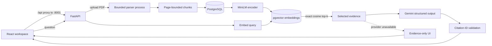

# TraceRAG

TraceRAG is an evidence-first AI research assistant for asking questions about PDF
documents. It combines bounded PDF ingestion, local sentence-transformer embeddings,
exact pgvector retrieval, and structured Gemini generation while keeping every returned
source passage inspectable.

The project addresses a practical RAG problem: an answer is only useful when a reviewer
can see where it came from—and when the system refuses to fabricate an answer after the
provider fails. TraceRAG therefore treats retrieved evidence and generated answers as
separate outputs. If Gemini is unavailable, the React interface shows the retrieval
results without inventing an answer or citations.

> **Verification status:** upload, parsing, indexing, semantic retrieval, citation
> validation, provider-failure handling, and the evidence-only UI path are verified.
> Live Gemini requests have reached the provider but recently returned HTTP 504/503 or
> timed out; successful live grounded generation and live answer quality remain unverified.

## What is implemented

| Capability | Status |
| --- | --- |
| PDF upload, bounded parsing, page metadata, and source-preserving chunks | Implemented and integration-tested |
| Idempotent indexing of persisted chunks without re-upload | Implemented and integration-tested |
| Pinned 384-dimensional MiniLM embeddings | Implemented; optional real-model smoke test |
| Exact cosine-distance retrieval with PostgreSQL and pgvector | Implemented and integration-tested |
| Structured Gemini answers constrained to selected evidence | Implemented; mocked tests pass, live success unverified |

## Architecture



The application is a modular monolith. Routes handle HTTP validation, services own
ingestion/retrieval/generation behavior, SQLAlchemy models own persistence, and the
provider and embedding adapters remain isolated and mockable.

## RAG data flow

1. **Ingest:** `POST /api/documents` streams a raw PDF through byte, page, extracted-text,
   decoded-stream, and parser-time limits. Original PDF bytes are discarded after parsing.
2. **Chunk:** normalized text is split into overlapping, page-bounded character windows
   (default 1,000 characters with 200 overlap). Chunks retain document ID, page number,
   offsets, and a stable chunk index, so retrieval results remain traceable.
3. **Embed:** `sentence-transformers/all-MiniLM-L6-v2` is pinned to a model revision and
   produces 384-dimensional vectors. Long text is token-windowed, pooled with content-token
   weights, and L2-normalized. Embeddings are profile-scoped and retry-safe.
4. **Retrieve:** the query is encoded with the same profile. PostgreSQL/pgvector performs
   exact cosine-distance search over fully indexed documents with deterministic ID
   tie-breaking. Similarity is ranking information, not calibrated confidence.
5. **Select evidence:** the top-k results are assigned source IDs (`S1`, `S2`, …) and
   fitted into a configured character budget before leaving the backend.
6. **Generate:** Gemini receives only the question and selected passages and must return
   structured JSON with an answer status and source IDs. Calls have a bounded overall
   deadline and one application-level retry for explicitly transient failures.
7. **Validate:** cited IDs must exist in the retrieved evidence. Invalid, missing, or
   contradictory citations are rejected. This proves source membership—not that every
   claim is entailed or factually correct.

## Technology

| Layer | Technology |
| --- | --- |
| Frontend | React 19, TypeScript 6, Vite 8, Vitest, Testing Library |
| API | FastAPI, Pydantic Settings, Uvicorn |
| Persistence | PostgreSQL 18, SQLAlchemy 2, Alembic, pgvector |
| Embeddings | Sentence Transformers, pinned MiniLM revision, PyTorch CPU inference |
| Generation | Google Gen AI SDK with structured output and safe error mapping |
| Tooling | uv, npm lockfile, Ruff, pytest, ESLint, GitHub Actions |

## Local setup

Verified development versions are uv 0.12.1, Python 3.13, and Node 26.7.0 with npm.
Document operations require PostgreSQL 18 with pgvector. Gemini is optional for upload,
indexing, and search; only `/api/ask` requires a valid provider key.

### 1. Install backend dependencies

From the repository root in PowerShell:

```powershell
Set-Location backend
uv python install 3.13
uv sync --frozen
```

### 2. Start PostgreSQL and migrate

With native PostgreSQL 18 on Windows:

```powershell
uv run --frozen python scripts/local_postgres.py start
uv run --frozen alembic upgrade head
```

The helper creates a project-owned cluster on `127.0.0.1:55432` and generates ignored
local credentials. Alternatively, Compose provisions **PostgreSQL only**—not FastAPI
or React:

```powershell
$env:POSTGRES_PASSWORD='choose-a-local-password'
docker compose up -d db
```

The Compose service binds `127.0.0.1:55432`, reports health through `pg_isready`, and
retains data in the `postgres_data` volume. Configure the matching database URL in
`backend/.env`, then run Alembic. Stop it with `docker compose down`; use `--volumes`
only when intentionally deleting the database. This path has been reviewed but not
executed on the current Docker-less verification machine.

### 3. Configure and start the backend

When configuring manually, copy `backend/.env.example` to `backend/.env`. Keep the real
file private. Important variables include:

| Variable | Purpose |
| --- | --- |
| `TRACERAG_DATABASE_URL` | `postgresql+psycopg` connection URL |
| `TRACERAG_GEMINI_API_KEY` | Optional for retrieval; required for generated answers |
| `TRACERAG_EMBEDDING_LOCAL_FILES_ONLY` | Prevent model downloads after weights are cached |
| `TRACERAG_LLM_TIMEOUT_SECONDS` | Overall provider deadline, validated from 1–120 seconds |

Start FastAPI from `backend/`:

```powershell
uv run --frozen uvicorn app.main:app --reload --host 127.0.0.1 --port 8001 --no-access-log
```

### 4. Start the frontend

From `frontend/` in another terminal:

```powershell
npm ci
npm run dev
```

Open `http://127.0.0.1:5173`. The checked-in Vite proxy sends `/api` requests to
`http://127.0.0.1:8001`. API documentation is at `http://127.0.0.1:8001/docs`.

`GET /api/health` is a process-liveness check only. It does not connect to PostgreSQL,
load the embedding model, or contact Gemini.

## API workflow

```text
POST   /api/documents?filename=paper.pdf   upload and parse
GET    /api/documents                     list documents
GET    /api/documents/{id}/chunks         inspect source chunks
POST   /api/documents/{id}/index          create missing embeddings
POST   /api/search                        retrieve ranked passages
POST   /api/ask                           retrieve, generate, and validate citations
DELETE /api/documents/{id}                cascade document and vector deletion
```

The complete request and error contracts are in [docs/api.md](docs/api.md) and
[docs/answers.md](docs/answers.md).

## Evaluation

The version-controlled `tracerag-synthetic-v1` benchmark contains two synthetic
documents, six fixed chunks, four answerable questions, and one explicitly unanswerable
question. Labels include relevant chunk IDs, pages, and expected facts. The runner uses
the configured MiniLM encoder and exact in-memory cosine ranking with stable tie-breaking.

| k | Recall@k | Precision@k | MRR@k |
| ---: | ---: | ---: | ---: |
| 1 | 0.875 | 1.000 | 1.000 |
| 3 | 1.000 | 0.417 | 1.000 |
| 5 | 1.000 | 0.250 | 1.000 |

Run it from `backend/` after the model is cached:

```powershell
$env:TRACERAG_EMBEDDING_LOCAL_FILES_ONLY='true'
uv run --frozen python -m app.evaluation.runner `
  --dataset ../evals/datasets/public/tracerag_v1.json `
  --cutoffs 1 3 5
```

This six-passage benchmark is too small to establish production retrieval quality. It
measures the encoder and ranking offline, not PDF parsing or PostgreSQL execution, and
its labels have not had independent review. No live Gemini answer-quality score has
been measured. See the [methodology](docs/evaluation.md) and
[executed report](docs/evaluation-report.md).

## Quality checks

```powershell
# backend/
uv run --frozen python scripts/local_postgres.py test
uv run --frozen ruff check .
uv run --frozen ruff format --check .

# frontend/
npm run lint
npm run typecheck
npm run test -- --run
npm run build
```

The backend suite uses a disposable `_test` database, synthetic PDFs, deterministic
fake vectors, and mocked Gemini responses. CI requires no real Gemini key and makes no
live provider call.

## Honest limitations and roadmap

- Successful live Gemini grounded generation is not yet verified; recent requests
  returned upstream 504/503 responses or exhausted the configured deadline.
- Citation validation confirms that IDs belong to retrieved passages; it does not prove
  claim-level entailment, factual correctness, or citation completeness.
- The retrieval benchmark is too small to establish production quality.
- Upload processing is synchronous; there is no durable queue or automatic recovery.
- Original PDF bytes are not retained, so there is no built-in page-image viewer.
- Scanned documents require OCR, which is not implemented.
- The local application has no authentication or multi-user isolation and is not a
  hardened public deployment.
- Hybrid keyword/vector retrieval, reranking, streaming, and chat history are possible
  future improvements, not current capabilities.

## Demo screenshots

No screenshots are committed yet. Suitable honest captures from the running application
are:

1. The main workspace showing **Backend connected**, an indexed PDF, and page/passage metadata.
2. A real provider-timeout state showing **Answer unavailable** beside five
   retrieval-only passages—demonstrating graceful degradation without a fabricated answer.
3. An expanded passage showing filename, page number, passage index, and source text.

Do not use a generated-answer screenshot until a real successful Gemini response has
been observed and its citations have been independently checked.

## Documentation

- [Architecture and decisions](docs/architecture.md)
- [Development and database setup](docs/development.md)
- [API contract](docs/api.md)
- [Embedding and retrieval design](docs/retrieval.md)
- [Grounded answers and provider behavior](docs/answers.md)
- [Evaluation methodology](docs/evaluation.md)
- [Latest evaluation report](docs/evaluation-report.md)
